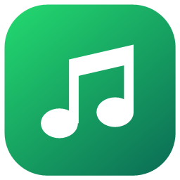
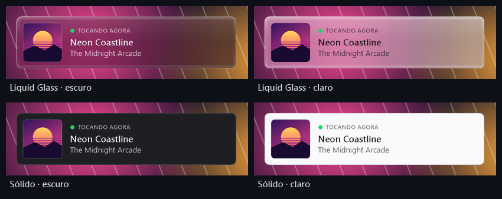

<div align="center">



# Spotify Toast

**Notificações de "tocando agora" no estilo console, com Liquid Glass, para o Spotify no Windows.**

Quando começa uma música nova, um cartão com a capa, o nome da faixa e o artista desliza da
borda da tela e some sozinho. Leve, discreto e sem atrapalhar seus jogos.

[](https://github.com/Ogabrkr/spotify-toast/releases/latest)


[](LICENSE)


[**⬇ Baixar o instalador**](https://github.com/Ogabrkr/spotify-toast/releases/latest) · [Recursos](#-recursos) · [Como funciona](#-como-funciona) · [Compilar](#-compilar-a-partir-do-código)

</div>

---

## ✨ Recursos

- 🎵 **Popup automático** a cada música nova no Spotify, com capa, título e artista
- 🫧 **Liquid Glass**: vidro desfocado de verdade, que reflete a cor da capa e acende com o mouse
- 🌗 **Tema claro, escuro ou automático** (segue o Windows), além de um estilo sólido
- 📏 **Três tamanhos** de popup: pequeno, médio e grande
- 🌐 **Português, inglês e espanhol** (ou o idioma do Windows)
- 😀 **Nomes com emoji** e caracteres especiais aparecem certinho
- 🎮 **Respeita tela cheia**: não aparece por cima de jogos, vídeos e apresentações (configurável)
- ⚡ **Levíssimo**: ~10–13 MB de memória (Gerenciador de Tarefas) e ~0% de CPU parado, sem ficar consultando o Spotify
- 🚀 **Inicia com o Windows** e fica quietinho no tray
- 🖱️ **Discreto**: não rouba o foco; clique no popup para fechar, passe o mouse para segurar
- 🖥️ **Nítido em qualquer DPI** e não invade o monitor vizinho ao deslizar

## 🎨 Estilos

<div align="center">

</div>

## ⚙️ Tudo pelo tray


Clique com o botão direito no ícone da nota musical:

| Opção | O que faz |
|---|---|
| **Estilo** | Liquid Glass ou Sólido |
| **Tema** | Escuro, Claro ou Seguir o Windows |
| **Posição** | Canto superior esquerdo ou direito |
| **Tamanho** | Pequeno, Médio ou Grande |
| **Duração** | 3, 5, 8 ou 12 segundos |
| **Idioma** | Automático (Windows), Português, English ou Español |
| **Aparecer sobre tela cheia** | Liga/desliga o popup durante jogos e vídeos |
| **Iniciar com o Windows** | Abre junto com o sistema |
| **Mostrar notificação** | Mostra a música atual de novo |
| **Fechar o app** | Encerra o Spotify Toast |

Clique com o botão esquerdo no ícone para ver a música que está tocando.

<br clear="right">

## 📦 Instalação

1. Baixe o **`SpotifyToast-Setup-x.y.z.exe`** na [página de releases](https://github.com/Ogabrkr/spotify-toast/releases/latest).
2. Abra o arquivo e clique em **Avançar → Instalar**. Não pede administrador e já traz o .NET embutido.
3. Pronto: o ícone aparece no tray e um popup de demonstração confirma que está funcionando.

> [!NOTE]
> Como o instalador ainda não tem assinatura digital, o Windows pode mostrar
> *"O Windows protegeu o computador"*. Clique em **Mais informações → Executar assim mesmo**.
> O código está todo aqui e o app não lê a tela, não acessa a internet e não coleta nada.

Para desinstalar: **Configurações → Aplicativos → Spotify Toast → Desinstalar**. Remove tudo,
inclusive a inicialização automática e as configurações.

**Requisitos:** Windows 10 (versão 2004 ou mais nova) ou Windows 11, 64 bits, com o app do Spotify
para desktop. O Liquid Glass fica melhor no Windows 11.

## 🔍 Como funciona

| | |
|---|---|
| **Detecção da música** | Usa o controle de mídia do próprio Windows (`GlobalSystemMediaTransportControlsSessionManager`, o mesmo do painel de volume). O Windows avisa quando a faixa muda, então o app não fica perguntando. |
| **Liquid Glass** | O desfoque é feito pelo compositor do Windows (DWM). Por cima, o app desenha a tinta, o reflexo da cor da capa, o brilho especular, a borda de lente e o aro de luz. Inspirado no material Liquid Glass do iOS 26, adaptado ao Windows. |
| **Animação** | O cartão é desenhado ao aparecer (e de novo só quando o mouse passa por cima); durante o deslize a janela só muda de posição. Com o app parado, nenhum timer roda; com o popup na tela, um timer leve confere se o mouse está em cima. |
| **Privacidade** | Nada de captura de tela, rede ou telemetria. As configurações ficam em `%APPDATA%\SpotifyToast\settings.json`. |

## 🛠️ Compilar a partir do código

Requer o [.NET SDK 10](https://dotnet.microsoft.com/download) e, para o instalador, o [Inno Setup 6](https://jrsoftware.org/isinfo.php):

```powershell
winget install Microsoft.DotNet.SDK.10 JRSoftware.InnoSetup

git clone https://github.com/Ogabrkr/spotify-toast.git
cd spotify-toast

dotnet run -c Release -- --demo            # roda e mostra a música atual
powershell -ExecutionPolicy Bypass -File build-installer.ps1   # gera dist\SpotifyToast-Setup-<versão>.exe
```

| Opção de linha de comando | Para quê |
|---|---|
| `--demo` | Mostra o popup com a música atual ao abrir |
| `--sample ["título"]` | Mostra uma música de exemplo (usada nas imagens deste README); o título é opcional, bom para testar emoji |
| `--show-menu` | Abre o menu do tray (usado nas imagens deste README) |

As imagens de `docs/` são geradas por `tools/make-preview.ps1`.

<details>
<summary><b>Estrutura do projeto</b></summary>

```
src/
  Program.cs        instância única, DPI por monitor, log de erros
  TrayApp.cs        ícone do tray, menu e configurações
  MediaWatcher.cs   eventos do Spotify pelo controle de mídia do Windows
  ToastWindow.cs    o popup: geometria, Liquid Glass, animação
  Native.cs         chamadas do Windows (desfoque, cantos, tela cheia, DPI)
  Fx.cs             formas, nota musical, cor predominante da capa
  TextLine.cs       texto com emoji (troca de fonte por trecho e corta com …)
  Lang.cs           textos em português, inglês e espanhol
  MenuRenderer.cs   menu do tray claro/escuro
installer/          script do Inno Setup
tools/              ícone e geração das imagens do README
```

</details>

## ❓ Perguntas frequentes

<details>
<summary><b>O popup não aparece.</b></summary>

Confira se é o app do Spotify para desktop (não o player no navegador) e se a música está tocando.
O popup aparece na **troca** de música; a que já tocava quando o app abriu não gera popup (clique
no ícone do tray para vê-la). Se você estiver em tela cheia, ligue *Aparecer sobre tela cheia*.
Erros ficam em `%APPDATA%\SpotifyToast\erros.log`.
</details>

<details>
<summary><b>Funciona com outros players?</b></summary>

Hoje ele escuta só o Spotify. A detecção usa o controle de mídia do Windows, então dá para
estender a outros players mudando o filtro em `src/MediaWatcher.cs`.
</details>

## 📄 Licença

[MIT](LICENSE) © Gabriel Kono

<sub>Projeto independente, sem ligação com o Spotify AB. "Spotify" é marca registrada da Spotify AB.</sub>
